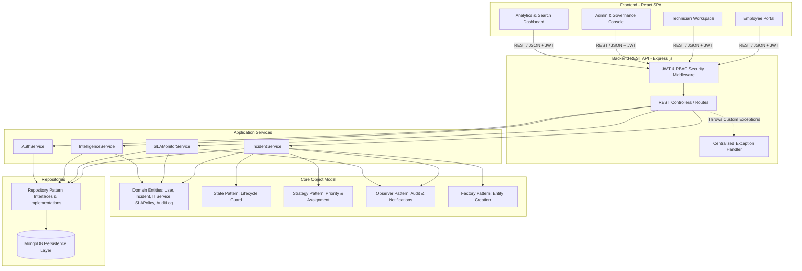
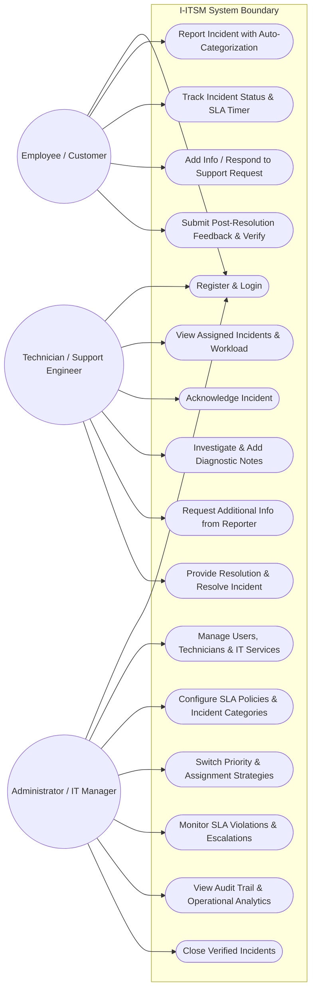
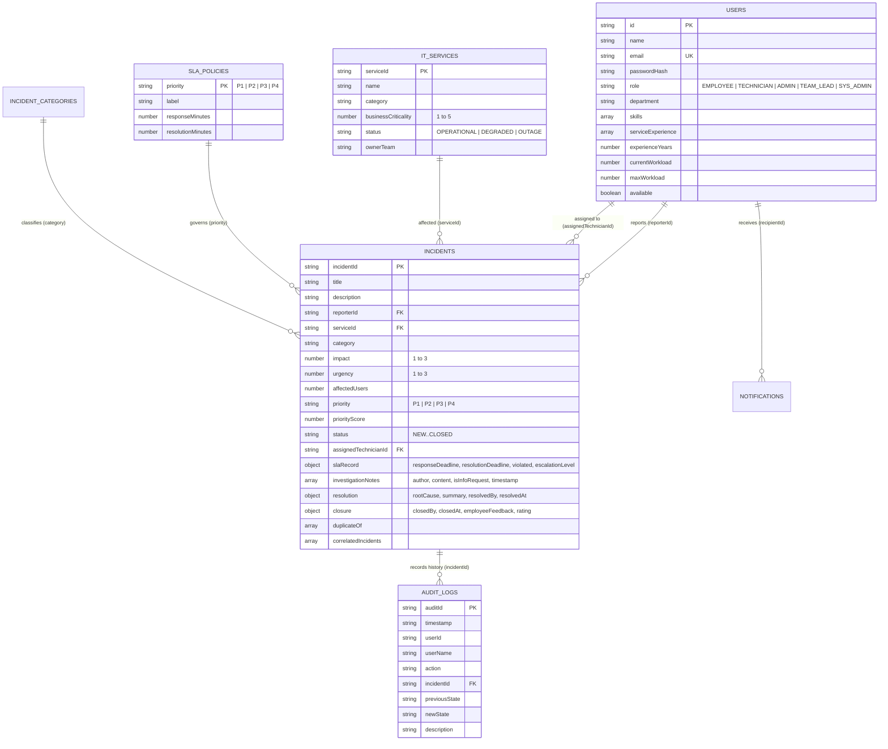

# CS F213 / MAC F212 Object-Oriented Programming — Project Report & Blueprint
## Intelligent IT Service Management & Incident Resolution System (I-ITSM)

---

## Deliverable 1: Problem Analysis

### 1.1 Problem Statement
Modern enterprises rely on interconnected IT services including cloud platforms, databases, payment gateways, authentication servers, networks, and storage infrastructure. When an IT service degrades or fails, employees and customers report incidents that must be rapidly classified, prioritized, routed to qualified technicians, investigated under strict Service Level Agreements (SLAs), resolved, verified, and audited. Manual incident triage leads to delayed responses, misprioritized critical outages, technician overload, unmonitored SLA breaches, duplicate tickets, and fragmented audit trails.

### 1.2 Stakeholders
1. **Employees / Customers (Reporters):** Report service disruptions, provide diagnostic responses when requested, track restoration progress, and submit post-resolution feedback.
2. **Technicians / Support Engineers (Resolvers):** Acknowledge assigned incidents, perform technical investigation, record diagnostic notes, request clarifications, and implement resolutions within SLA targets.
3. **Administrators / IT Managers (Governors):** Configure IT services, incident categories, SLA policies, and assignment/prioritization strategies; oversee technician capacity, SLA compliance, escalation chains, and operational analytics.

### 1.3 Existing Challenges Addressed
- **Delayed Response & Manual Triage:** Eliminated via automated classification, priority scoring, and immediate strategy-driven technician assignment.
- **Incorrect Prioritization:** Solved via deterministic Priority Strategies combining *Impact × Urgency × Service Business Criticality*.
- **Inefficient Technician Allocation:** Solved via interchangeable `SkillBased`, `LoadBased`, `RoundRobin`, and `ExperienceBased` assignment strategies.
- **Unmonitored SLA Violations:** Addressed via continuous SLA deadline calculation, warning thresholds (75% elapsed), violation detection, and 4-tier automatic escalation (`Technician → Team Lead → System Administrator → IT Manager`).
- **Duplicate Reports & Recurring Incidents:** Addressed via intelligent similarity matching, service correlation, and historical resolution recommendations.

### 1.4 Proposed Solution
An enterprise-grade **Intelligent IT Service Management & Incident Resolution System (I-ITSM)** built on a strict **Layered Object-Oriented Architecture** using React (Frontend), Node.js/Express with ES6+ Domain Classes (Backend), and MongoDB (Persistence Layer).

### 1.5 Key Assumptions
- Each IT service is registered in the Service Catalog with an assigned **Business Criticality** level (1 = Low to 5 = Mission Critical).
- Technicians declare their technical skill tags, service experience, and maximum concurrent workload capacity (default: 5 active incidents).
- External Email and SMS gateways are simulated through dedicated `EmailNotificationObserver` and `SMSNotificationObserver` classes alongside real-time in-app notifications.

---

## Deliverable 2: Requirements Specification

### 2.1 Functional Requirements (Mapped to Problem Scenario Steps 1–14)
1. **User Authentication & Self-Registration:** Employees can register new accounts and log in; Technicians and Administrators authenticate via role-protected credentials.
2. **Incident Creation (Step 1):** Employees submit incidents specifying title, description, affected service, impact, urgency, and affected user count.
3. **Incident Classification (Step 2):** Supports Hardware, Software, Network, Database, Cloud, Security, Authentication, Application, and Storage, plus dynamic admin-defined categories and automated NLP keyword classification.
4. **Affected Service & Business Impact Identification (Steps 3–4):** Links the incident to an `ITService` entity and retrieves its business criticality rating.
5. **Intelligent Priority Calculation (Step 5):** Computes Priority Score and assigns `P1 (Critical)`, `P2 (High)`, `P3 (Medium)`, or `P4 (Low)` using the active `PriorityStrategy`.
6. **SLA Determination & Deadline Calculation (Step 6):** Maps priority to SLA targets (`P1: 5m/30m`, `P2: 15m/2h`, `P3: 1h/8h`, `P4: 4h/24h`) and computes exact response and resolution timestamps.
7. **Technician Identification & Assignment (Steps 7–8):** Evaluates available technicians using the configured `AssignmentStrategy` and transitions the incident to `ASSIGNED`.
8. **Multi-Channel Notification (Step 9):** Dispatches In-App and Simulated Email notifications upon incident creation, assignment, priority change, SLA warning/violation, resolution, and closure.
9. **Investigation & Resolution Tracking (Step 10):** Enforces state transitions (`NEW → CLASSIFIED → ASSIGNED → ACKNOWLEDGED → IN_PROGRESS → RESOLVED → VERIFIED → CLOSED`), supporting investigation notes and employee info requests/responses.
10. **Continuous SLA Monitoring & Auto-Escalation (Step 11):** Tracks response and resolution compliance, flags approaching deadlines and breaches, and escalates unacknowledged critical incidents across `Technician → Team Lead → System Administrator → IT Manager`.
11. **Complete Audit Trail (Step 12):** Records every state transition and action with timestamp, actor, incident ID, previous state, new state, and description.
12. **Verification, Feedback & Closure (Step 13):** Allows verification and employee feedback before transitioning to `CLOSED`.
13. **Search, Filtering & Operational Analytics (Step 14):** Supports filtering across 8 criteria (Incident ID, Date range, Status, Priority, Category, Service, Technician, SLA Status) and generates Incident Overview, Technician Workload, and Service Analysis reports.

### 2.2 Non-Functional Requirements
- **Maintainability & Extensibility:** New categories, assignment algorithms, priority formulas, and notification channels can be added via Open/Closed Principle (OCP) without modifying core incident orchestration logic.
- **Security:** JWT-based stateless authentication, bcrypt/SHA-256 password hashing, role-based access control (RBAC) middleware, and input sanitization.
- **Resilience:** Centralized exception handling for all 12 domain/infrastructure error scenarios.

---

## Deliverable 3: System Architecture

The system follows **Choice 1: Layered Architecture** from the project specification:

---

## Deliverable 4: UML Diagrams

### 4.1 Use Case Diagram

### 4.2 Class Diagram (Showing Inheritance, Encapsulation, Composition, Aggregation, and Design Patterns)

```mermaid
classDiagram
    class User {
        <<abstract>>
        #String id
        #String name
        #String email
        #String passwordHash
        #String role
        #Boolean active
        +getId() String
        +getRole() String
        +getPermissions()* String[]
        +canTransitionTo(targetState)* Boolean
    }

    class Employee {
        -String department
        -String location
        +getPermissions() String[]
        +canTransitionTo(targetState) Boolean
    }

    class Technician {
        -String[] skills
        -String[] serviceExperience
        -Number experienceYears
        -Number currentWorkload
        -Number maxWorkload
        -Boolean available
        +hasSkill(category) Boolean
        +canAcceptAssignment() Boolean
        +incrementWorkload() void
        +decrementWorkload() void
    }

    class Administrator {
        -String accessLevel
        +getPermissions() String[]
        +canTransitionTo(targetState) Boolean
    }

    User <|-- Employee : Inheritance (is-a)
    User <|-- Technician : Inheritance (is-a)
    User <|-- Administrator : Inheritance (is-a)

    class Incident {
        -String incidentId
        -String title
        -String description
        -String category
        -Number impact
        -Number urgency
        -String priority
        -Number priorityScore
        -String status
        -SLARecord slaRecord
        -InvestigationNote[] investigationNotes
        -ResolutionDetails resolution
        -ClosureDetails closure
        +transitionState(newState, actor) void
        +addInvestigationNote(author, note) void
        +applyResolution(details) void
        +closeIncident(actor, feedback) void
    }

    class SLARecord {
        -Date responseDeadline
        -Date resolutionDeadline
        -Date acknowledgedAt
        -Date resolvedAt
        -Boolean responseViolated
        -Boolean resolutionViolated
        -String escalationLevel
        +evaluateCompliance(now) Object
    }

    class InvestigationNote {
        -String noteId
        -String authorName
        -String content
        -Boolean isInfoRequest
        -Date timestamp
    }

    class ResolutionDetails {
        -String rootCause
        -String resolutionSummary
        -String resolvedBy
        -Date resolvedAt
    }

    class ITService {
        -String serviceId
        -String name
        -String category
        -Number businessCriticality
        -String status
    }

    Incident *-- SLARecord : Composition
    Incident *-- InvestigationNote : Composition
    Incident *-- ResolutionDetails : Composition
    Incident o-- ITService : Aggregation (affectedService)
    Incident o-- Technician : Association (assignedTechnician)
    Incident o-- Employee : Association (reporter)

    class IncidentState {
        <<interface>>
        +getName() String
        +getAllowedNextStates() String[]
        +validateTransition(targetState) void
    }

    class PriorityStrategy {
        <<interface>>
        +calculatePriority(incident, service) Object
    }

    class RuleBasedPriorityStrategy {
        +calculatePriority(incident, service) Object
    }

    class WeightedScoringPriorityStrategy {
        +calculatePriority(incident, service) Object
    }

    PriorityStrategy <|.. RuleBasedPriorityStrategy
    PriorityStrategy <|.. WeightedScoringPriorityStrategy

    class AssignmentStrategy {
        <<interface>>
        +selectTechnician(incident, technicians) Technician
    }

    class SkillBasedAssignmentStrategy {
        +selectTechnician(incident, technicians) Technician
    }

    class LoadBasedAssignmentStrategy {
        +selectTechnician(incident, technicians) Technician
    }

    class RoundRobinAssignmentStrategy {
        +selectTechnician(incident, technicians) Technician
    }

    class ExperienceBasedAssignmentStrategy {
        +selectTechnician(incident, technicians) Technician
    }

    AssignmentStrategy <|.. SkillBasedAssignmentStrategy
    AssignmentStrategy <|.. LoadBasedAssignmentStrategy
    AssignmentStrategy <|.. RoundRobinAssignmentStrategy
    AssignmentStrategy <|.. ExperienceBasedAssignmentStrategy

    class IncidentObserver {
        <<interface>>
        +update(event, payload) void
    }

    class AuditLogObserver {
        +update(event, payload) void
    }

    class InAppNotificationObserver {
        +update(event, payload) void
    }

    class EmailSimulationObserver {
        +update(event, payload) void
    }

    IncidentObserver <|.. AuditLogObserver
    IncidentObserver <|.. InAppNotificationObserver
    IncidentObserver <|.. EmailSimulationObserver
```

---

## Deliverable 5: Technology Stack & Technology Selection Report

### Answers to the 9 Mandatory Technology Selection Questions (PDF Page 12)

1. **Why did you choose this programming language (JavaScript / ES6+ with OOP Classes)?**
   - Modern ES2022+ JavaScript supports full class-based Object-Oriented Programming (`class`, `extends`, `super`, `#private` fields, getters/setters, static factory methods, and polymorphic method overriding) while unifying the language across the Frontend (React), Backend (Node.js/Express), and JSON document model (MongoDB).
2. **Why did you choose this frontend technology (React 18 + Vite)?**
   - React's component-based architecture mirrors OOP encapsulation and composition in the UI. Role-specific portals (`EmployeePortal`, `TechnicianPortal`, `AdminPortal`, `ReportsDashboard`) manage state predictably and update SLA timers, workflow actions, and notification drawers dynamically without full-page reloads.
3. **Why did you choose this backend technology (Node.js / Express)?**
   - Express provides a clean middleware pipeline ideal for cross-cutting enterprise concerns (JWT authentication, RBAC authorization, and polymorphic custom exception handling) while keeping the HTTP routing layer thin so business logic stays strictly inside the OOP Domain and Service layers.
4. **Why did you select this database (MongoDB)?**
   - An `Incident` naturally forms a rich aggregate root containing embedded value objects (`SLARecord`, `InvestigationNote[]`, `ResolutionDetails`, `ClosureDetails`). MongoDB stores this aggregate cohesively without expensive multi-table joins while allowing indexed queries across all 8 required filter criteria.
5. **Why did you choose this architecture (Layered Full-Stack Architecture)?**
   - Separating Presentation, REST API, Business Services, OOP Domain/Patterns, and Data Repositories enforces Single Responsibility (SRP) and Dependency Inversion (DIP). Strategies, state rules, and repositories can be unit-tested or swapped independently of the UI.
6. **What alternatives did you consider?**
   - *Spring Boot + PostgreSQL:* Strong static typing, but requires higher boilerplate and separate ORM mapping for nested incident notes/audit histories.
   - *Django/FastAPI + SQLite:* Rapid prototyping, but file-locked SQLite is less suited for concurrent background SLA monitoring and document-oriented audit trails.
7. **What are the advantages and limitations of your technology stack?**
   - *Advantages:* High developer velocity for a 3-person team, unified JSON serialization, zero-downtime schema extensibility for dynamic incident categories, and non-blocking I/O for real-time SLA checks and notifications.
   - *Limitations:* JavaScript lacks compile-time interface enforcement compared to Java/C#, which we mitigated by creating explicit abstract base classes (`User`, `IncidentState`, `PriorityStrategy`, `AssignmentStrategy`, `IncidentObserver`, `BaseRepository`) that throw runtime contract errors if abstract methods are not implemented.
8. **How does your technology support object-oriented design?**
   - Every core concept is modeled as a first-class class in `backend/src/domain/` and `backend/src/patterns/`. Private properties (`#field` / encapsulated getters), inheritance hierarchies, polymorphic strategy execution, state-machine objects, observer subscriptions, and custom exception hierarchies are implemented directly in the domain layer.
9. **How would your system evolve if the number of users increased significantly?**
   - Stateless JWT authentication allows horizontal scaling of Node.js API instances behind an Nginx/ALB load balancer; MongoDB scales via replica sets and sharding on `incidentId` / `createdAt`; the in-process `IncidentEventPublisher` (Observer Pattern) can be swapped for a Kafka/RabbitMQ message broker without changing the `IncidentService` interface.

---

## Deliverable 6: Team of 3 Students — Role & Module Allocation

| Team Member | Primary Role | Owned Modules & OOP Responsibilities |
| :--- | :--- | :--- |
| **Student 1** | **Frontend Architecture, Role Portals & Analytics UI** | `frontend/src/components/*` (`LoginRegister`, `EmployeePortal`, `TechnicianPortal`, `AdminPortal`, `ReportsDashboard`, `NotificationCenter`), 8-criteria search/filter bar, live SLA countdown badges, and UX state feedback. |
| **Student 2** | **Core OOP Domain Model, Design Patterns & Intelligent Engine** | `backend/src/domain/*` (`User`, `Employee`, `Technician`, `Administrator`, `Incident`, `ITService`, `SLAPolicy`), `backend/src/patterns/*` (State, Strategy, Factory, Observer patterns), and `IntelligenceService.js` (Duplicate Detection, Correlation, Smart Recommendation, Auto-Categorization, Historical Resolution). |
| **Student 3** | **Persistence Layer, SLA Engine, Security, Exceptions & Testing** | `backend/src/repositories/*` (Repository Pattern + Dual MongoDB/Memory Store), `SLAMonitorService.js` (SLA deadlines, violation detection, 4-tier escalation), `AppExceptions.js` (12 custom exceptions), JWT/RBAC middleware, and `backend/tests/itsm.test.js` (18 automated test cases). |

---

## Deliverable 7: Database Design

### 7.1 Entity-Relationship / Document Schema Diagram

---

## Deliverable 8: Testing Specification (18 Automated Test Cases)

All 18 test cases are implemented and executable via `cd backend && npm test`:

| Test ID | Category | Test Case Description | Expected Outcome |
| :--- | :--- | :--- | :--- |
| **TC-01** | Normal Operation | Employee self-registration & login with valid credentials | Returns 201/200 with JWT token and `EMPLOYEE` role permissions |
| **TC-02** | Exception (`InvalidLoginException`) | Login attempt with wrong password or unknown email | Throws `InvalidLoginException` (HTTP 401) |
| **TC-03** | Authorization (`UnauthorizedOperationException`) | Employee attempts admin-only SLA policy modification | Throws `UnauthorizedOperationException` (HTTP 403) |
| **TC-04** | OOP Inheritance & Polymorphism | Instantiate `Employee`, `Technician`, `Administrator` via `UserFactory` | Each subclass returns distinct polymorphic permissions and transition guards |
| **TC-05** | Priority Strategy (Rule-Based) | High Impact (3) × High Urgency (3) × Critical Payment Service (5) | Calculates score = 45 → Classifies as `P1 (Critical)` |
| **TC-06** | Priority Strategy (Weighted Scoring) | Switch active strategy to `WeightedScoringPriorityStrategy` | Dynamically computes weighted score without altering `IncidentService` |
| **TC-07** | SLA Calculation (P1–P4 Targets) | Create `P1` incident and verify SLA deadlines | Sets Response Target = +5 mins, Resolution Target = +30 mins |
| **TC-08** | Assignment Strategy (Skill-Based vs Load-Based) | Assign Payment/Application incident under `SKILL_BASED` then `LOAD_BASED` | Selects skilled technician first; selects lowest-workload technician when switched |
| **TC-09** | State Pattern (Valid Lifecycle) | Step through `NEW → CLASSIFIED → ASSIGNED → ACKNOWLEDGED → IN_PROGRESS → RESOLVED → VERIFIED → CLOSED` | All transitions succeed and decrement technician workload on resolution |
| **TC-10** | State Pattern (`InvalidStateTransitionException`) | Attempt direct jump `NEW → CLOSED` or `ASSIGNED → RESOLVED` | Throws `InvalidStateTransitionException` (HTTP 400) |
| **TC-11** | Boundary Condition (`TechnicianWorkloadExceededException`) | Assign incident when all matching technicians are at `maxWorkload` | Throws `TechnicianWorkloadExceededException` / queues for escalation |
| **TC-12** | Intelligent Feature A (Duplicate Detection) | Report `"Payment transaction failing"` while `"Payment application unavailable"` is open | Flags new incident as potential duplicate and links `INC101` |
| **TC-13** | Intelligent Feature B & G (Correlation & Suggested Resolution) | Report incident on service with historical resolved incidents | Correlates active service incidents and returns historical resolution steps |
| **TC-14** | Intelligent Feature C & E (SLA Violation & 4-Tier Escalation) | Simulate unacknowledged P1 incident past 5-minute response deadline | Marks response SLA violated and escalates `Technician → Team Lead → System Administrator → IT Manager` |
| **TC-15** | Intelligent Feature F (Auto-Categorization) | Submit description `"VPN router packet loss and DNS firewall outage"` | Suggests `Network` category automatically |
| **TC-16** | Observer Pattern (Audit Trail & Notifications) | Perform incident creation, assignment, and resolution | Automatically records immutable `AuditLog` entries and creates In-App + Simulated Email notifications |
| **TC-17** | Dynamic Category Extensibility | Admin adds new category `"Biometric IoT"` at runtime | New incidents can immediately be classified under `"Biometric IoT"` |
| **TC-18** | Multi-Criteria Search & Reporting | Query incidents by Priority=`P1`, Category=`Application`, SLA=`VIOLATED` | Returns matching subset and accurate overview/workload/service aggregations |
